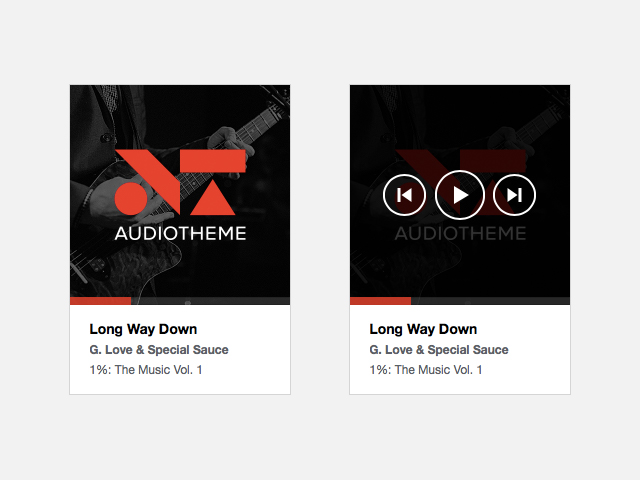

# Audiocheck jPlayer Skin

A responsive HTML5 jPlayer skin with playlist. [View Demo](https://lukemcdonald.github.io/jplayer-skin-audiocheck/)

**Contributors:** [Luke McDonald](https://lukemcdonald.com)  
**Requires:** [jPlayer](https://github.com/jplayer/jPlayer)  
**License:** [MIT license](https://opensource.org/licenses/MIT)



## Architecture: one source of truth for the current track

Track info, the playlist highlight and the scroll position are all rendered
from a single snapshot, so they cannot drift apart on a track change, a rapid
sequence of skips, a load failure, or a display-mode switch.

| Module | Responsibility |
| --- | --- |
| `src/assets/js/player-store.js` | `PlayerStore` — the single source of truth. Holds the current index, the last confirmed-playable index, and any load error. `getView()` returns the one snapshot everything reads from: resolved track, highlight index (`-1` when nothing is valid), error and revision. |
| `src/assets/js/player-view.js` | `PlaylistView` — renders info, highlight, error notice and scroll from a store snapshot; owns display-mode switching (presentation only) and re-scrolls the current track into view. |
| `src/assets/js/scroll.js` | Pure `computeScrollTop` maths (no DOM), so scrolling can be unit-tested. |
| `src/assets/js/jplayer.js` | `JPlayerManager` — bridges jPlayer callbacks (`ready`/`setmedia`/`play`/`ended`/`error`) to the store. Reads jPlayer's authoritative `playlist.current` on every callback and ignores callbacks whose media no longer matches the selected track. |
| `src/assets/js/app.js` | Thin shell: touch detection, display-mode toggles (presentation only — never skips a track), and a state probe. |

Behaviour guarantees:

- **One round of updates.** Every track change renders track info, highlight and
  scroll from the same store snapshot, in one pass.
- **Stale callbacks lose.** A late `play`/`error` for a media URL that is no
  longer selected is ignored, so the newest track's info is never overwritten.
- **Display switches are presentation-only.** Playback and the current track are
  untouched; the highlight is re-asserted and the current track is scrolled back
  into view for the new layout.
- **Load failures keep the last good track.** Its info stays on screen, a visible
  notice appears, and the failed row is flagged (`jp-playlist-failed`) without
  the highlight pointing at a missing or failed row.
- **Empty / looping playlists never throw.** `next`/`previous` wrap when looping
  and return `null` when there is nothing to select.

## Local verification

Unit and integration tests run under [Vitest](https://vitest.dev/) + jsdom against
a deterministic fake jPlayer playlist — no network audio or jQuery required.

```sh
npm install
npm test          # one-shot
npm run test:watch
```

The suite covers the four required scenarios:

- **Normal track change** — info, highlight and scroll stay consistent on
  play/setmedia.
- **Rapid consecutive changes** — only the last skip wins; late `play`/`error`
  callbacks for superseded tracks are ignored.
- **Display-mode switch** — current track, highlight and playing state survive
  every switch, and the current track is scrolled back into view.
- **Load failure** — the previous track's info is kept, a notice is shown, and
  the failed row is flagged without stealing the highlight.

There is also a browser harness that exercises the same wiring against the fake
playlist and prints a pass/fail summary:

```sh
npm run dev
# then open http://localhost:5173/dev-harness.html
```

## Licenses

Bundled demo audio in `src/assets/media/audio/`: MDN [interactive-examples](https://developer.mozilla.org/) CC0 sample (`t-rex-roar.mp3`), plus three short [Mixkit](https://mixkit.co/) preview effects (`mixkit-arcade-bonus-alert.mp3`, `mixkit-soft-ping.mp3`, `mixkit-game-reward.mp3`) under the Mixkit Sound Effects Free License.

jPlayer is licensed under the MIT.
Source: https://opensource.org/licenses/MIT
